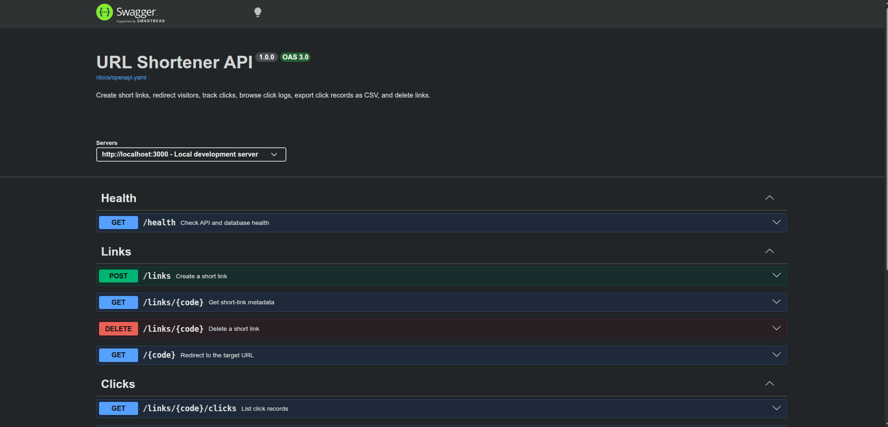

# 🔗 URL Shortener API

> A RESTful URL Shortener API built with Node.js, Express, and PostgreSQL that converts long URLs into short links, redirects visitors to their destinations, tracks clicks, and provides paginated click history and CSV exports.

---

## 📌 Problem Statement

Long URLs can be inconvenient to share, manage, and track. A URL shortening service provides a simple way to generate compact links while preserving the original destination.

This project demonstrates how to build a backend API that manages short links, handles HTTP redirects, records visitor activity, and stores data reliably using PostgreSQL.

The project also focuses on request validation, database transactions, keyset pagination, automated testing, API documentation, and containerized deployment.

---

## 🎯 Project Goals

- Build a RESTful API using Node.js and Express.
- Create short links using generated or custom codes.
- Implement HTTP redirects and link expiration.
- Store short links and click records in PostgreSQL.
- Track clicks using atomic counter updates and database transactions.
- Implement keyset pagination for click history.
- Export click records as streamed CSV files.
- Validate incoming requests using Zod.
- Prevent SQL injection through parameterized database queries.
- Document API endpoints using OpenAPI and Swagger UI.
- Containerize the API and PostgreSQL database using Docker Compose.
- Write automated integration tests using Node.js's built-in test runner.
- Practice backend development, database management, and API testing.

---

## 🛠 Tech Stack

**Backend**

- Node.js
- Express 5
- JavaScript (ES Modules)

**Database**

- PostgreSQL
- `pg` PostgreSQL client and connection pooling

**Validation and Documentation**

- Zod
- OpenAPI 3
- Swagger UI Express

**Testing and Deployment**

- Node.js built-in test runner (`node:test`)
- Docker
- Docker Compose
- GitHub Actions
- Super-Linter

**Development Tools**

- Git and GitHub
- VS Code
- npm
- curl

---

## 🖥 Features

- Create short links from valid HTTP and HTTPS URLs.
- Generate short codes automatically.
- Support custom short codes.
- Reject duplicate codes and invalid input.
- Redirect visitors using HTTP `302 Found`.
- Support optional link expiration.
- Return HTTP `410 Gone` for expired links.
- Return link metadata, including click counts.
- Record click timestamps, referrers, and user-agent information.
- Increment click counters atomically within database transactions.
- Retrieve click history using keyset pagination.
- Export click history as streamed CSV.
- Delete short links and their associated click records.
- Validate requests at the API boundary using Zod.
- Use parameterized SQL queries for database operations.
- Check application and database connectivity through a health endpoint.
- Provide interactive API documentation with Swagger UI.
- Seed sample links for a fresh Docker database.
- Run the API and PostgreSQL in separate Docker containers.
- Automate integration tests and code-quality checks through GitHub Actions.

---

## 🗺 API Endpoints

| Method | Endpoint | Description |
|---|---|---|
| `GET` | `/health` | Check API and database health |
| `POST` | `/links` | Create a short link |
| `GET` | `/:code` | Redirect to the original URL |
| `GET` | `/links/:code` | Retrieve link metadata |
| `GET` | `/links/:code/clicks` | Retrieve paginated click history |
| `GET` | `/links/:code/clicks.csv` | Export click history as CSV |
| `DELETE` | `/links/:code` | Delete a short link |
| `GET` | `/docs` | Open interactive API documentation |

### Example: Create a Short Link

**Request**

```http
POST /links
Content-Type: application/json
```

```json
{
  "target_url": "https://example.com/articles",
  "code": "my-article",
  "expires_at": "2030-01-01T12:00:00Z"
}
```

The `code` and `expires_at` fields are optional. When a custom code is not supplied, the API generates one automatically.

**Example using curl**

```bash
curl -i -X POST http://localhost:3000/links \
  -H "Content-Type: application/json" \
  -d '{"target_url":"https://example.com/articles","code":"my-article"}'
```

**Possible responses**

- `201 Created` — short link created successfully.
- `400 Bad Request` — invalid request data.
- `409 Conflict` — the requested code already exists.

### Example: Redirect to a Destination

```bash
curl -i http://localhost:3000/my-article
```

A valid link returns `302 Found` with a `Location` header containing the destination URL.

An unknown code returns `404 Not Found`, while an expired link returns `410 Gone`.

### Example: Retrieve Link Metadata

```bash
curl -i http://localhost:3000/links/my-article
```

The response includes the code, target URL, creation timestamp, expiry timestamp, and click count.

### Example: Retrieve Click History

```bash
curl -i "http://localhost:3000/links/my-article/clicks?limit=20"
```

The API returns the click records and a `next_cursor` value when another page is available. Pass that cursor using the `after` query parameter to retrieve the next page.

The supported page size is between 1 and 100 records.

### Example: Export Click History

```bash
curl -sS \
  -o clicks.csv \
  http://localhost:3000/links/my-article/clicks.csv
```

The endpoint streams click data as CSV. Fields are escaped, including protection against spreadsheet formula injection.

### Example: Delete a Short Link

```bash
curl -i -X DELETE http://localhost:3000/links/my-article
```

A successful deletion returns `204 No Content`. The associated click records are removed through the database's foreign-key cascade.

---

## 🗄 Database Design

The application uses two PostgreSQL tables.

**`links`**

Stores:

- Link ID and unique short code.
- Original destination URL.
- Creation and optional expiry timestamps.
- Total click count.

**`clicks`**

Stores:

- Click ID and associated link ID.
- Click timestamp.
- HTTP referrer.
- User-agent information.

### Data Integrity and Performance

- Unique constraints prevent duplicate short codes.
- A check constraint prevents negative click counts.
- Foreign-key cascading removes clicks when their link is deleted.
- An index supports click-history queries ordered by timestamp and ID.
- Parameterized SQL queries protect database operations from SQL injection.
- Click-count updates and click-record insertion are performed in one transaction.
- Keyset pagination avoids relying on offset-based pagination for click history.

---

## 📸 Screenshot



---

## ⚙ Installation and Setup

### 📥 Clone the Repository

```bash
git clone https://github.com/Hache-premier/Url-Shortener-Api.git
cd Url-Shortener-Api
```

### 📦 Install Dependencies

Make sure Node.js 22 or newer, npm, and PostgreSQL are installed for local development.

```bash
npm ci
```

### 🔐 Configure Environment Variables

Create a local environment file from the example:

```bash
cp .env.example .env
```

Edit `.env` with your local database configuration.

```dotenv
NODE_ENV=development
PORT=3000
BASE_URL=http://localhost:3000

DB_HOST=localhost
DB_PORT=5432
DB_NAME=url_shortener
DB_USER=url_shortener_app
DB_PASSWORD=your_local_database_password
DB_POOL_MAX=10
```

Use the credentials appropriate for your machine. Never commit real passwords or secrets to GitHub.

### 🗃 Prepare the Database

Create the development database and PostgreSQL role if they do not already exist. Then apply the schema:

```bash
psql -h localhost \
  -U url_shortener_app \
  -d url_shortener \
  -W \
  -f db/schema.sql
```

To add the sample links to your local database, run:

```bash
psql -h localhost \
  -U url_shortener_app \
  -d url_shortener \
  -W \
  -f db/seed.sql
```

### ▶ Run the Application

Start the development server with automatic restarts:

```bash
npm run dev
```

Or start the application normally:

```bash
npm start
```

Check the API health:

```bash
curl -i http://localhost:3000/health
```

A successful response returns HTTP `200 OK` with the database status set to `connected`.

### 📚 Open the API Documentation

With the server running, visit:

- **Swagger UI:** `http://localhost:3000/docs`
- **OpenAPI specification:** `http://localhost:3000/docs/openapi.yaml`

Swagger UI allows you to inspect the endpoints, examine request schemas, and send API requests interactively.

---

## 🐳 Docker and Docker Compose

Docker Compose runs the API and PostgreSQL in separate containers.

### 1. Install Docker

Install Docker Engine and the Docker Compose plugin using the official installation instructions:

https://docs.docker.com/engine/install/ubuntu/

Verify the installation:

```bash
docker --version
docker compose version
```

### 2. Build and Start the Containers

Ensure `.env` is configured, then run:

```bash
sudo docker compose up --build -d
```

The database container initializes a fresh database using `db/schema.sql` and loads the sample links from `db/seed.sql`. The API starts after PostgreSQL becomes healthy.

If host port `3000` is already in use, you can publish the API on port `3001`:

```bash
sudo env PORT=3001 BASE_URL=http://localhost:3001 \
  docker compose up --build -d
```

### 3. Verify the Containers

```bash
sudo docker compose ps
```

Test the Docker API using the selected host port:

```bash
curl -i http://localhost:3001/health
curl -sS http://localhost:3001/links/welcome
```

Use port `3000` instead when running on the default host port.

### 4. Stop the Containers

```bash
sudo docker compose down
```

The named PostgreSQL volume preserves its data after the containers stop.

**Important:** PostgreSQL initialization scripts run only when its data directory is first initialized. If the volume already exists, changing `db/seed.sql` will not automatically insert the new seed records.

---

## 🧪 Testing

The project uses Node.js's built-in test runner, so an additional testing framework is not required.

### Prepare the Dedicated Test Database

The integration test suite uses a separate database named `url_shortener_test`.

Create the database if it does not already exist:

```bash
sudo -u postgres createdb \
  --owner=url_shortener_app \
  url_shortener_test
```

Apply the schema:

```bash
psql -h localhost \
  -U url_shortener_app \
  -d url_shortener_test \
  -W \
  -f db/schema.sql
```

### Run the Tests

```bash
npm test
```

The integration suite covers:

- Health and database connectivity.
- Link creation and metadata retrieval.
- Request validation and duplicate codes.
- Redirects and link expiration.
- Click recording and counter updates.
- Keyset pagination and invalid cursors.
- Concurrent redirects and click-counter consistency.
- CSV export.
- Link deletion and cascading removal of click records.
- SQL injection regression checks.
- Swagger UI and OpenAPI documentation routes.

The project currently has **14 passing integration tests**.

**Database safety:** The test suite clears records from `url_shortener_test` before and after its run. Never point the test suite at your development or production database.

### Continuous Integration

GitHub Actions is configured to run the integration tests against a separate PostgreSQL service and run Super-Linter on the repository when code is pushed or pull requests are opened.

---

## 🧠 Challenges Faced

- Designing a clear REST API for short-link management.
- Validating URLs, custom codes, and expiry timestamps.
- Recording clicks while maintaining a consistent counter.
- Handling database transactions and rollback behavior.
- Implementing keyset pagination using timestamps and IDs.
- Streaming CSV data without buffering the entire export.
- Preventing SQL injection through parameterized queries.
- Keeping automated tests isolated from the development database.
- Documenting endpoints using OpenAPI and Swagger UI.
- Configuring Docker networking, PostgreSQL initialization, and container health checks.

---

## 📚 What I Learned

- How to build REST APIs with Express.
- How to organize code using controllers, services, repositories, and schemas.
- How to connect Node.js to PostgreSQL using connection pooling.
- How to maintain data consistency using transactions.
- How atomic updates help preserve click-counter accuracy.
- How keyset pagination works in database-backed APIs.
- How to validate incoming data using Zod.
- How to stream responses and export CSV data.
- How to test API behavior using Node.js's built-in test runner.
- How to document APIs with OpenAPI and Swagger UI.
- How to containerize an application and database using Docker Compose.
- How to automate testing and code-quality checks through GitHub Actions.

---

## 🚀 Future Improvements

- Add analytics for top referrers and link performance.
- Introduce rate limiting for link creation and redirects.
- Add an expiry-cleanup worker.
- Implement authentication and user-specific link management.
- Add QR-code generation for short links.
- Extend API tests with more failure and edge-case scenarios.
- Add performance benchmarks for redirects and click-history queries.
- Publish a deployed API with a public base URL.
- Add more detailed monitoring and structured logging.

---

## 👨🏽‍💻 Author

**Ndonwi Ashley Cheo**
Software Engineering

🌍 Based in Cameroon | Passionate about backend development, software engineering, and continuously learning new technologies. 🚀

---

## 📄 License

This project currently uses the license declared in `package.json`. Confirm that the repository contains the corresponding license file before describing the project as open source under a specific license.
