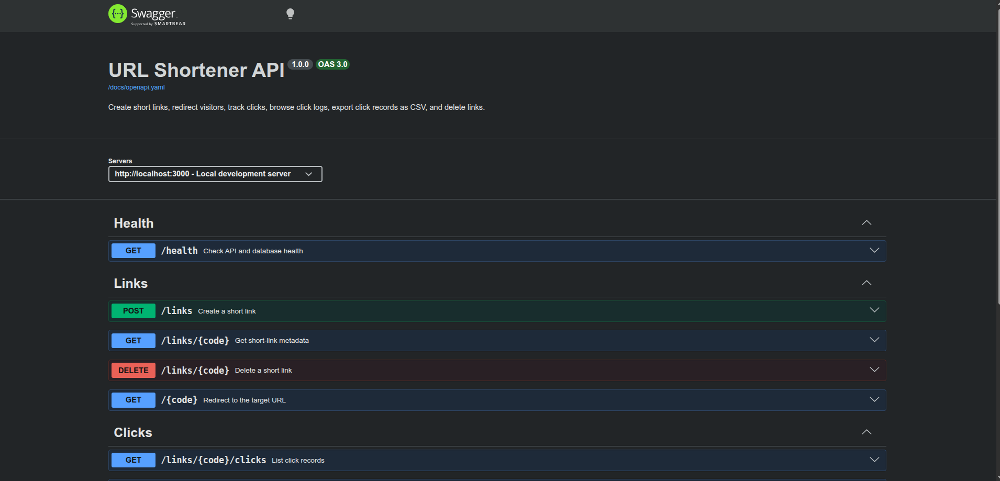
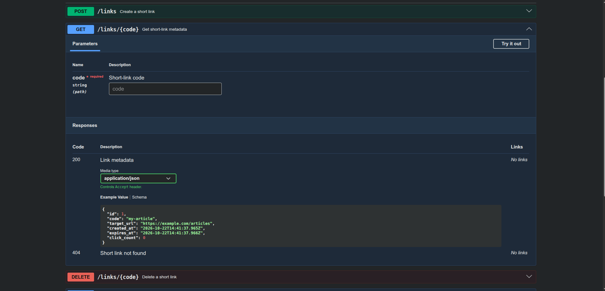
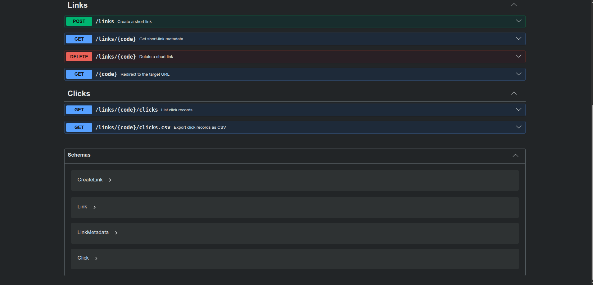
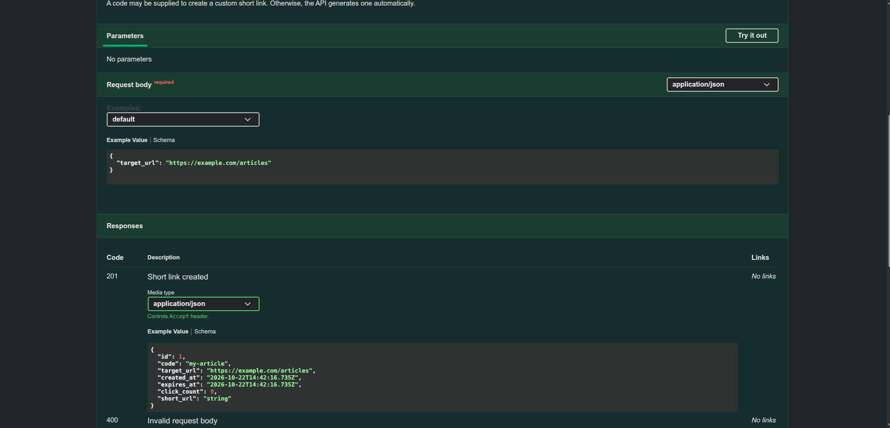
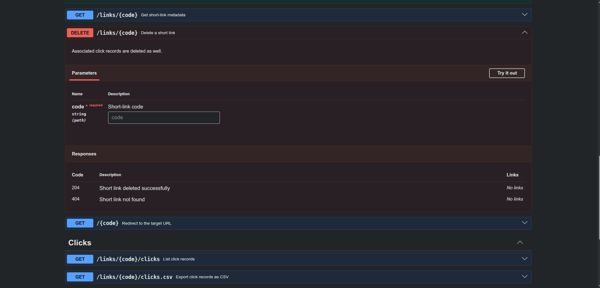
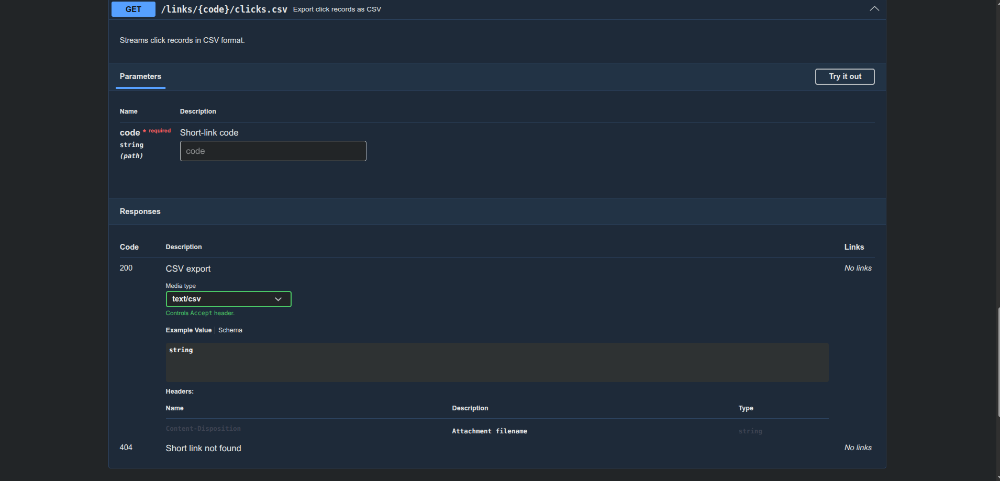

# 🔗 URL Shortener API

> A RESTful URL Shortener API built with Node.js, Express, and PostgreSQL. It converts long URLs into short links, redirects visitors to their destinations, tracks clicks, and provides paginated click history and CSV exports.

---

## 📌 Problem Statement

Long URLs can be inconvenient to share, manage, and track. A URL shortening service provides a simple way to generate compact links while preserving the original destination making it easy to manipulate.

This project demonstrates how to build a backend API that manages short links, handles HTTP redirects, records visitor activity, and stores data reliably using PostgreSQL.

The project also focuses on request validation, database transactions, keyset pagination, automated testing, API documentation, and database management.

---

## 🎯 Project Goals

- Build a RESTful API using Node.js and Express.
- Create short links using generated or custom codes.
- Implement HTTP redirects and link expiration.
- Store short links and click records in PostgreSQL.
- Track clicks using atomic counter updates and database transactions.
- Implement keyset pagination for click history.
- Export click records as streamed CSV files.
- Validate incoming requests using Zod.
- Prevent SQL injection through parameterized database queries.
- Document API endpoints using OpenAPI and Swagger UI.
- Write automated integration tests using Node.js's built-in test runner.
- Practice backend development, database management, and API testing.

---

## 🛠 Tech Stack

### Backend

- Node.js
- Express 5
- JavaScript (ES Modules)

### Database

- PostgreSQL
- `pg` PostgreSQL client and connection pooling

### Validation and Documentation

- Zod
- OpenAPI 3
- Swagger UI Express

### Testing and Continuous Integration

- Node.js built-in test runner (`node:test`)
- GitHub Actions
- Super-Linter

### Development Tools

- Git and GitHub
- VS Code
- npm
- curl

---

## 🖥 Features

- Create short links from valid HTTP and HTTPS URLs.
- Generate short codes automatically.
- Support custom short codes.
- Reject duplicate codes and invalid input.
- Redirect visitors using HTTP `302 Found`.
- Support optional link expiration.
- Return HTTP `410 Gone` for expired links.
- Return link metadata, including click counts.
- Record click timestamps, referrers, and user-agent information.
- Increment click counters atomically within database transactions.
- Retrieve click history using keyset pagination.
- Export click history as streamed CSV.
- Delete short links and their associated click records.
- Validate requests at the API boundary using Zod.
- Use parameterized SQL queries for database operations.
- Check application and database connectivity through a health endpoint.
- Provide interactive API documentation with Swagger UI.
- Support local PostgreSQL database setup and sample data seeding.
- Run the API directly using Node.js.
- Automate integration tests and code-quality checks through GitHub Actions.

---

## 🗺 API Endpoints

| Method   | Endpoint                  | Description                        |
| -------- | ------------------------- | ---------------------------------- |
| `GET`    | `/health`                 | Check API and database health      |
| `POST`   | `/links`                  | Create a short link                |
| `GET`    | `/:code`                  | Redirect to the original URL       |
| `GET`    | `/links/:code`            | Retrieve link metadata             |
| `GET`    | `/links/:code/clicks`     | Retrieve paginated click history   |
| `GET`    | `/links/:code/clicks.csv` | Export click history as CSV        |
| `DELETE` | `/links/:code`            | Delete a short link                |
| `GET`    | `/docs`                   | Open interactive API documentation |

### Example: Create a Short Link

_Request_*

```http
POST /links
Content-Type: application/json
```

_Request body_*

```json
{
  "target_url": "https://example.com/articles",
  "code": "my-article",
  "expires_at": "2030-01-01T12:00:00Z"
}
```

The `code` and `expires_at` fields are optional. When a custom code is not supplied, the API generates one automatically.

_Example using curl_*

```bash
curl -i -X POST http://localhost:3000/links \
  -H "Content-Type: application/json" \
  -d '{"target_url":"https://example.com/articles","code":"my-article"}'
```

_Possible responses_*

- `201 Created` — short link created successfully.
- `400 Bad Request` — invalid request data.
- `409 Conflict` — the requested code already exists.

### Example: Redirect to a Destination

```bash
curl -i http://localhost:3000/my-article
```

A valid link returns `302 Found` with a `Location` header containing the destination URL.

An unknown code returns `404 Not Found`, while an expired link returns `410 Gone`.

### Example: Retrieve Link Metadata

```bash
curl -i http://localhost:3000/links/my-article
```

The response includes the code, target URL, creation timestamp, expiry timestamp, and click count.

### Example: Retrieve Click History

```bash
curl -i "http://localhost:3000/links/my-article/clicks?limit=20"
```

The API returns click records and a `next_cursor` value when another page is available. Pass that cursor using the `after` query parameter to retrieve the next page.

The supported page size is between 1 and 100 records.

### Example: Export Click History

```bash
curl -sS \
  -o clicks.csv \
  http://localhost:3000/links/my-article/clicks.csv
```

The endpoint streams click data as CSV. Fields are escaped, including protection against spreadsheet formula injection.

### Example: Delete a Short Link

```bash
curl -i -X DELETE http://localhost:3000/links/my-article
```

A successful deletion returns `204 No Content`. The associated click records are removed through the database's foreign-key cascade.

---

## 🗄 Database Design

The application uses two PostgreSQL tables.

### `links`

Stores:

- Link ID and unique short code.
- Original destination URL.
- Creation and optional expiry timestamps.
- Total click count.

### `clicks`

Stores:

- Click ID and associated link ID.
- Click timestamp.
- HTTP referrer.
- User-agent information.

### Data Integrity and Performance

- Unique constraints prevent duplicate short codes.
- A check constraint prevents negative click counts.
- Foreign-key cascading removes clicks when their link is deleted.
- An index supports click-history queries.
- Parameterized SQL queries protect database operations from SQL injection.
- Click-count updates and click-record insertion are performed in one transaction.
- Keyset pagination avoids relying on offset-based pagination for click history.

---

## 📸 Screenshots

The following screenshots demonstrate the API documentation and Swagger UI interface.













---

## ⚙ Installation and Setup

### Prerequisites

Make sure the following tools are installed:

- Node.js 22 or newer
- npm
- PostgreSQL
- Git

### 1. Clone the Repository

```bash
git clone https://github.com/Hache-premier/Url-Shortener-Api.git

cd Url-Shortener-Api
```

### 2. Install Dependencies

```bash
npm ci
```

### 3. Prepare PostgreSQL

Make sure PostgreSQL is installed and running.

Create a PostgreSQL role and database if they do not already exist.

Open the PostgreSQL shell:

```bash
sudo -u postgres psql
```

Create the application role:

```sql
CREATE ROLE url_shortener_app WITH LOGIN PASSWORD 'your_local_database_password';
```

Create the development database:

```sql
CREATE DATABASE url_shortener OWNER url_shortener_app;
```

Exit the PostgreSQL shell:

```sql
\q
```

Use your own secure password when creating the role.

### 4. Configure Environment Variables

Create a local environment file from the example:

```bash
cp .env.example .env
```

Edit `.env` with your local database configuration:

```dotenv
NODE_ENV=development
PORT=3000
BASE_URL=http://localhost:3000

DB_HOST=localhost
DB_PORT=5432
DB_NAME=url_shortener
DB_USER=url_shortener_app
DB_PASSWORD=your_local_database_password
DB_POOL_MAX=10
```

Make sure the database credentials match the PostgreSQL role you created.

Never commit real passwords or secrets to GitHub.

### 5. Apply the Database Schema

Run the following command to create the required database tables and constraints:

```bash
psql -h localhost \
  -U url_shortener_app \
  -d url_shortener \
  -W \
  -f db/schema.sql
```

### 6. Seed Sample Data

To add sample links to your local database, run:

```bash
psql -h localhost \
  -U url_shortener_app \
  -d url_shortener \
  -W \
  -f db/seed.sql
```

### 7. Run the Application

Start the development server with automatic restarts:

```bash
npm run dev
```

Or start the application normally:

```bash
npm start
```

### 8. Check API Health

With the server running, open another terminal and execute:

```bash
curl -i http://localhost:3000/health
```

A successful response returns HTTP `200 OK` with the database status set to `connected`.

### 9. Open the API Documentation

With the server running, visit:

- _Swagger UI:_* <http://localhost:3000/docs>
- _OpenAPI specification:_* <http://localhost:3000/docs/openapi.yaml>

Swagger UI allows you to inspect the endpoints, examine request schemas, and send API requests interactively.

---

## 🧪 Testing

The project uses Node.js's built-in test runner, so an additional testing framework is not required.

### 1. Prepare the Dedicated Test Database

The integration test suite uses a separate database named `url_shortener_test`.

Create the database if it does not already exist:

```bash
sudo -u postgres createdb \
  --owner=url_shortener_app \
  url_shortener_test
```

Apply the schema:

```bash
psql -h localhost \
  -U url_shortener_app \
  -d url_shortener_test \
  -W \
  -f db/schema.sql
```

### 2. Run the Tests

```bash
npm test
```

### Test Coverage

The integration suite covers:

- Health and database connectivity.
- Link creation and metadata retrieval.
- Request validation and duplicate codes.
- Redirects and link expiration.
- Click recording and counter updates.
- Keyset pagination and invalid cursors.
- Concurrent redirects and click-counter consistency.
- CSV export.
- Link deletion and cascading removal of click records.
- SQL injection regression checks.
- Swagger UI and OpenAPI documentation routes.

The original project test report records **14 passing integration tests**.

**Database safety:** The test suite clears records from `url_shortener_test` before and after its run. Never point the test suite at your development or production database.

### Continuous Integration

GitHub Actions is configured to run integration tests against a separate PostgreSQL service and run Super-Linter on the repository when code is pushed or pull requests are opened.

---

## 🧠 Challenges Faced

- Designing a clear REST API for short-link management.
- Validating URLs, custom codes, and expiry timestamps.
- Recording clicks while maintaining a consistent counter.
- Handling database transactions and rollback behavior.
- Implementing keyset pagination using timestamps and IDs.
- Streaming CSV data without buffering the entire export.
- Preventing SQL injection through parameterized queries.
- Keeping automated tests isolated from the development database.
- Documenting endpoints using OpenAPI and Swagger UI.
- Configuring automated testing and code-quality checks.

---

## 📚 What I Learned

- How to build REST APIs with Express.
- How to organize code using controllers, services, repositories, and schemas.
- How to connect Node.js to PostgreSQL using connection pooling.
- How to maintain data consistency using transactions.
- How atomic updates help preserve click-counter accuracy.
- How keyset pagination works in database-backed APIs.
- How to validate incoming data using Zod.
- How to stream responses and export CSV data.
- How to test API behavior using Node.js's built-in test runner.
- How to document APIs with OpenAPI and Swagger UI.
- How to manage PostgreSQL databases for development and testing.
- How to automate testing and code-quality checks through GitHub Actions.

---

## 🚀 Future Improvements

- Add analytics for top referrers and link performance.
- Introduce rate limiting for link creation and redirects.
- Add an expiry-cleanup worker.
- Implement authentication and user-specific link management.
- Add QR-code generation for short links.
- Extend API tests with more failure and edge-case scenarios.
- Add performance benchmarks for redirects and click-history queries.
- Deploy the API with a public base URL.
- Add more detailed monitoring and structured logging.

---

## 👨🏽‍💻 Author

_Ndonwi Ashley Cheo_*

Software Engineering

🌍 Based in Cameroon | Passionate about backend development, software engineering, and continuously learning new technologies. 🚀
